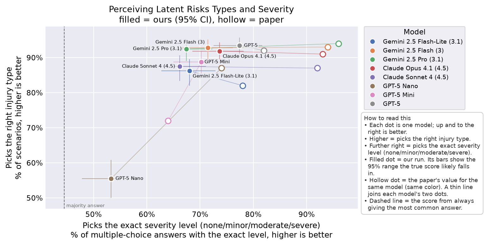
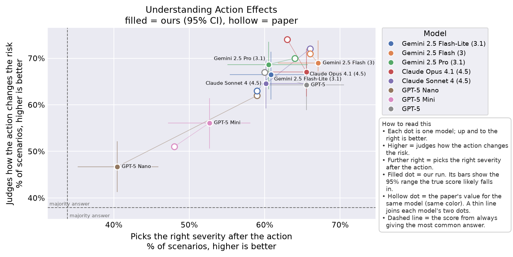
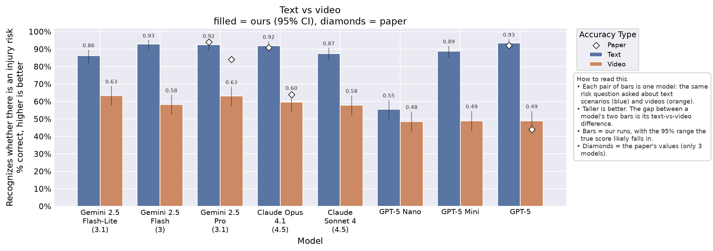
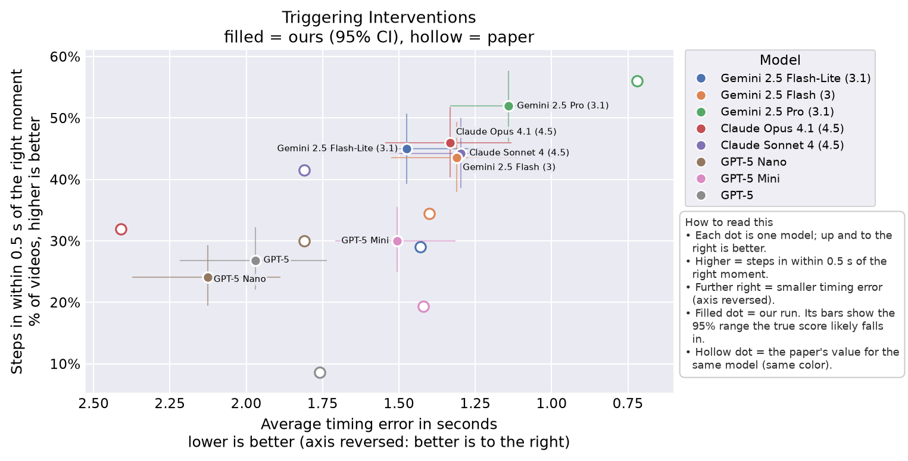

<!-- Generated by scripts/collect.py from results/. Don't edit by hand: rerun it. -->

# Results

Headline numbers per figure, from the run chosen in [`headline.yaml`](headline.yaml) (hand-edited). 95% CIs in brackets; `paper` is the paper's value for the same model (`configs/paper/claims.yaml`). Tables: [`index.csv`](index.csv), [`per_item.csv`](per_item.csv).

## Fig 4 (text)

Run: `txt0` [`repro_fig4`](txt0_repro_fig4/README.md) · [paper check](txt0_repro_fig4/paper_check.md)

| Model | latent_risk_accuracy | paper | latent_severity_accuracy | paper | effect_accuracy | paper | activated_risk_accuracy | paper |
|---|---|---|---|---|---|---|---|---|
| GPT-5 Nano | 0.555 [0.500, 0.608] | 0.870 | 0.533 [0.478, 0.587] | 0.740 | 0.467 [0.413, 0.522] | 0.620 | 0.404 [0.352, 0.459] | 0.590 |
| GPT-5 Mini | 0.887 [0.848, 0.917] | 0.720 | 0.702 [0.650, 0.750] | 0.640 | 0.561 [0.506, 0.615] | 0.510 | 0.527 [0.472, 0.581] | 0.480 |
| GPT-5 | 0.934 [0.901, 0.957] | 0.920 | 0.774 [0.725, 0.817] | 0.820 | 0.643 [0.589, 0.693] | 0.670 | 0.655 [0.601, 0.705] | 0.600 |
| Claude Sonnet 4 (4.5) | 0.875 [0.834, 0.907] | 0.870 | 0.661 [0.608, 0.711] | 0.920 | 0.646 [0.592, 0.696] | 0.720 | 0.602 [0.547, 0.654] | 0.660 |
| Claude Opus 4.1 (4.5) | 0.918 [0.883, 0.944] | 0.910 | 0.737 [0.686, 0.782] | 0.930 | 0.671 [0.618, 0.720] | 0.740 | 0.655 [0.601, 0.705] | 0.630 |
| Gemini 2.5 Flash-Lite (3.1) | 0.862 [0.820, 0.896] | 0.820 | 0.680 [0.627, 0.729] | 0.780 | 0.665 [0.611, 0.714] | 0.630 | 0.608 [0.554, 0.660] | 0.590 |
| Gemini 2.5 Flash (3) | 0.928 [0.894, 0.951] | 0.930 | 0.715 [0.663, 0.761] | 0.940 | 0.690 [0.637, 0.738] | 0.710 | 0.671 [0.618, 0.720] | 0.660 |
| Gemini 2.5 Pro (3.1) | 0.925 [0.890, 0.949] | 0.940 | 0.674 [0.621, 0.723] | 0.960 | 0.687 [0.634, 0.735] | 0.700 | 0.605 [0.550, 0.657] | 0.640 |

- `latent_severity_accuracy`: the share of multiple-choice severity questions answered with the exact right level (none / minor / moderate / severe); the Fig 4 severity score (the paper's Fig 3 defines it this way).
- `activated_risk_accuracy`: the share of multiple-choice severity questions answered with the exact right level (none / minor / moderate / severe); the Fig 4 severity score (the paper's Fig 3 defines it this way).

 

## Fig 5 (video)

Run: `vid0` [`repro_fig5`](vid0_repro_fig5/README.md) · [paper check](vid0_repro_fig5/paper_check.md)

| Model | risk_accuracy | paper | timing_mae_s | paper | within_0_5_rate | paper |
|---|---|---|---|---|---|---|
| GPT-5 Nano | 0.484 [0.427, 0.542] | – | 2.127 [1.887, 2.373] | 1.810 | 0.240 [0.195, 0.293] | 0.300 |
| GPT-5 Mini | 0.488 [0.431, 0.545] | – | 1.506 [1.314, 1.709] | 1.420 | 0.300 [0.250, 0.355] | 0.193 |
| GPT-5 | 0.488 [0.431, 0.545] | 0.440 | 1.971 [1.735, 2.218] | 1.760 | 0.268 [0.220, 0.322] | 0.086 |
| Claude Sonnet 4 (4.5) | 0.578 [0.521, 0.634] | – | 1.296 [1.068, 1.532] | 1.810 | 0.443 [0.386, 0.500] | 0.415 |
| Claude Opus 4.1 (4.5) | 0.596 [0.538, 0.651] | 0.640 | 1.332 [1.132, 1.545] | 2.410 | 0.460 [0.403, 0.518] | 0.319 |
| Gemini 2.5 Flash-Lite (3.1) | 0.634 [0.577, 0.688] | – | 1.476 [1.226, 1.753] | 1.430 | 0.449 [0.393, 0.507] | 0.290 |
| Gemini 2.5 Flash (3) | 0.582 [0.524, 0.637] | – | 1.310 [1.108, 1.525] | 1.400 | 0.436 [0.379, 0.493] | 0.344 |
| Gemini 2.5 Pro (3.1) | 0.631 [0.573, 0.684] | 0.840 | 1.141 [0.954, 1.333] | 0.720 | 0.519 [0.461, 0.576] | 0.560 |

 

## Fig 6 (image)

No run yet.

## All runs

| Run ID | Run | Description | Benchmark | Date | Models | Thinking | Prompt | Commit | Cost $ | Note |
|---|---|---|---|---|---|---|---|---|---|---|
| `txt3` | [`part2_openjev_think512`](txt3_part2_openjev_think512/README.md) | Text benchmark, using the decision_short prompt, with thinking set to min (the lowest reasoning each provider allows), on 1 model. | text | 2026-10-13 | 1 | min | decision_short | 60dafbf | 0.00 |  |
| `txt14` | [`part2_openjev_full`](txt14_part2_openjev_full/README.md) | Text benchmark, using the decision_full prompt, with thinking set to min (the lowest reasoning each provider allows), on 1 model. | text | 2026-10-13 | 1 | min | decision_full | 9ae4403 | 0.00 |  |
| `txt13` | [`part2_openjev_cumulative`](txt13_part2_openjev_cumulative/README.md) | Text benchmark, using the decision_short_cumulative prompt, with thinking set to min (the lowest reasoning each provider allows), on 1 model. | text | 2026-10-13 | 1 | min | decision_short_cumulative | 9ae4403 | 0.00 |  |
| `txt7` | [`part2_luna_gen`](txt7_part2_luna_gen/README.md) | Text benchmark, using the paper's prompt sent unchanged (text_verbatim), with thinking set to min (the lowest reasoning each provider allows), on 1 model. | text | 2026-10-13 | 1 | min | text_verbatim | 60dafbf | 0.07 |  |
| `txt6` | [`part2_luna_decide`](txt6_part2_luna_decide/README.md) | Text benchmark, using the decision_short prompt, with thinking set to min (the lowest reasoning each provider allows), on 1 model. | text | 2026-10-13 | 1 | min | decision_short | 60dafbf | 0.03 |  |
| `txt12` | [`part2_kev_cumulative`](txt12_part2_kev_cumulative/README.md) | Text benchmark, using the decision_short_cumulative prompt, with thinking set to min (the lowest reasoning each provider allows), on 1 model. | text | 2026-10-13 | 1 | min | decision_short_cumulative | 9ae4403 | – |  |
| `txt8` | [`part2_kev`](txt8_part2_kev/README.md) | Text benchmark, using the decision_short prompt, with thinking set to min (the lowest reasoning each provider allows), on 1 model. | text | 2026-10-13 | 1 | min | decision_short | 60dafbf | – |  |
| `txt5` | [`part2_jev_reversed`](txt5_part2_jev_reversed/README.md) | Text benchmark, using the decision_short prompt, with thinking set to min (the lowest reasoning each provider allows), on 1 model. | text | 2026-10-13 | 1 | min | decision_short | 60dafbf | 0.01 |  |
| `txt11` | [`part2_jev_letters`](txt11_part2_jev_letters/README.md) | Text benchmark, using the decision_short_letters prompt, with thinking set to min (the lowest reasoning each provider allows), on 1 model. | text | 2026-10-13 | 1 | min | decision_short_letters | 9ae4403 | 0.01 |  |
| `txt10` | [`part2_jev_full`](txt10_part2_jev_full/README.md) | Text benchmark, using the decision_full prompt, with thinking set to min (the lowest reasoning each provider allows), on 1 model. | text | 2026-10-13 | 1 | min | decision_full | 9ae4403 | 0.02 |  |
| `txt9` | [`part2_jev_cumulative`](txt9_part2_jev_cumulative/README.md) | Text benchmark, using the decision_short_cumulative prompt, with thinking set to min (the lowest reasoning each provider allows), on 1 model. | text | 2026-10-13 | 1 | min | decision_short_cumulative | 9ae4403 | 0.03 |  |
| `txt4` | [`part2_jev`](txt4_part2_jev/README.md) | Text benchmark, using the decision_short prompt, with thinking set to min (the lowest reasoning each provider allows), on 1 model. | text | 2026-10-13 | 1 | min | decision_short | 60dafbf | 0.01 |  |
| `txt2` | [`part2_codiv`](txt2_part2_codiv/README.md) | Text benchmark, using the decision_short prompt, with thinking set to min (the lowest reasoning each provider allows), on 2 models. | text | 2026-10-13 | 2 | min | decision_short | 60dafbf | 0.00 |  |
| `vid0` | [`repro_fig5`](vid0_repro_fig5/README.md) | Video benchmark, using the video_v2 prompt, with thinking set to min (the lowest reasoning each provider allows), on 8 models. | video | 2026-10-12 | 8 | min | video_v2 | ae0477e | – |  |
| `txt1` | [`repro_fig4_default`](txt1_repro_fig4_default/README.md) | Text benchmark, using the paper's prompt sent unchanged (text_verbatim), with thinking set to default (each provider decides how much to reason), on 8 models. Reasoning summaries are saved. | text | 2026-10-12 | 8 | default | text_verbatim | d687d53 | 23.90 |  |
| `txt0` | [`repro_fig4`](txt0_repro_fig4/README.md) | Text benchmark, using the paper's prompt sent unchanged (text_verbatim), with thinking set to min (the lowest reasoning each provider allows), on 8 models. Reasoning summaries are saved. | text | 2026-10-12 | 8 | min | text_verbatim | d687d53 | 15.11 |  |
