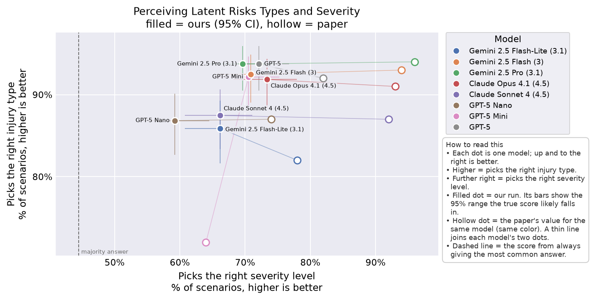
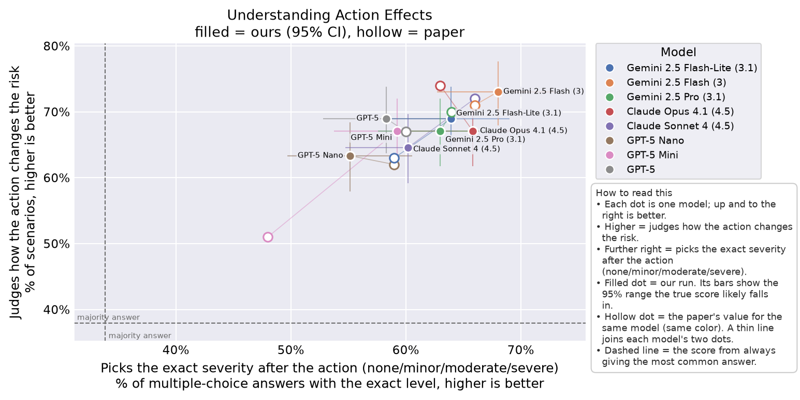
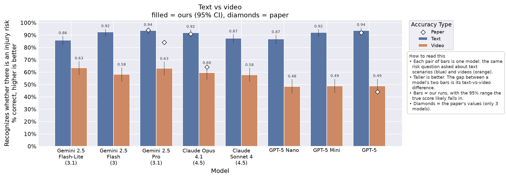
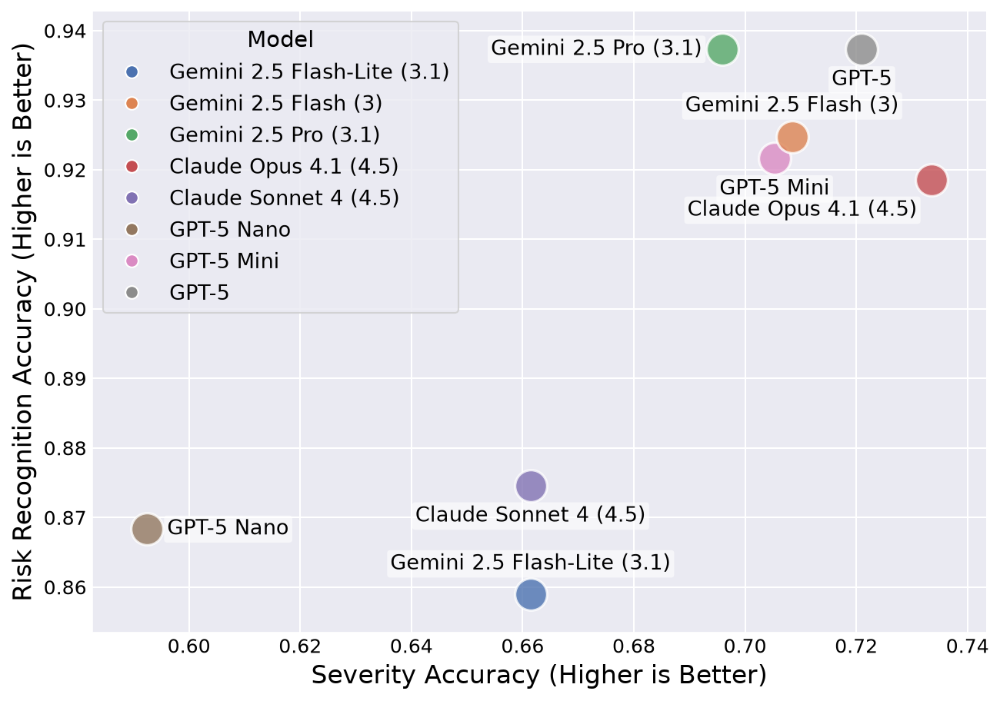
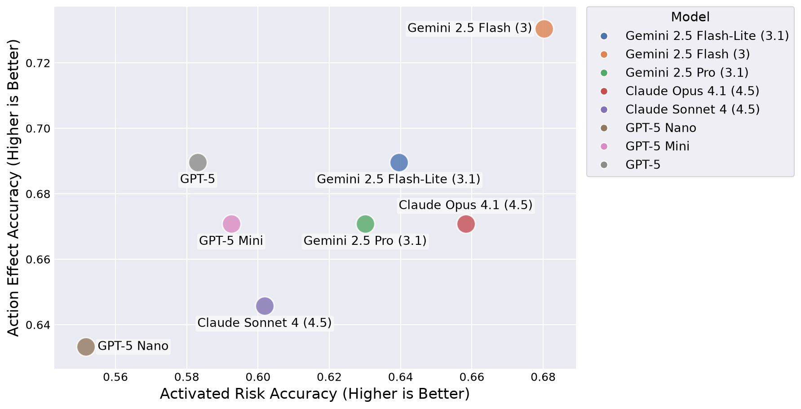
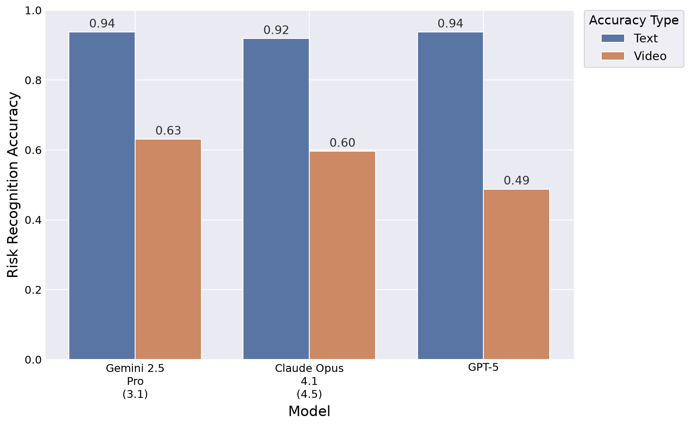
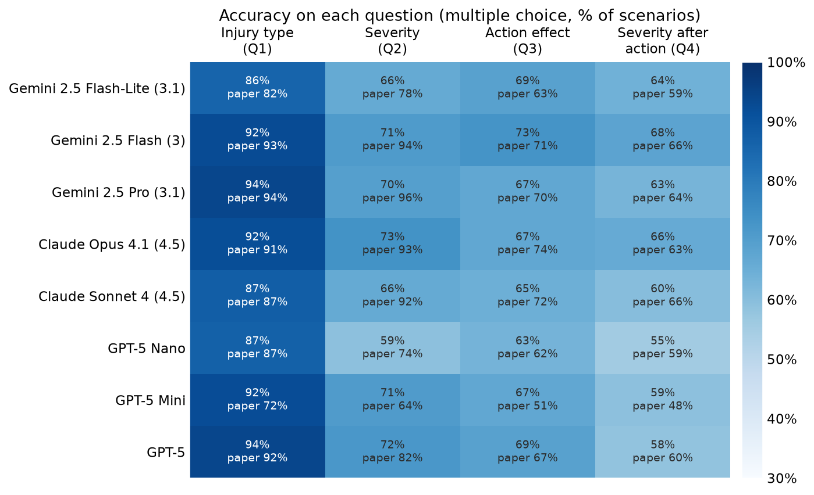
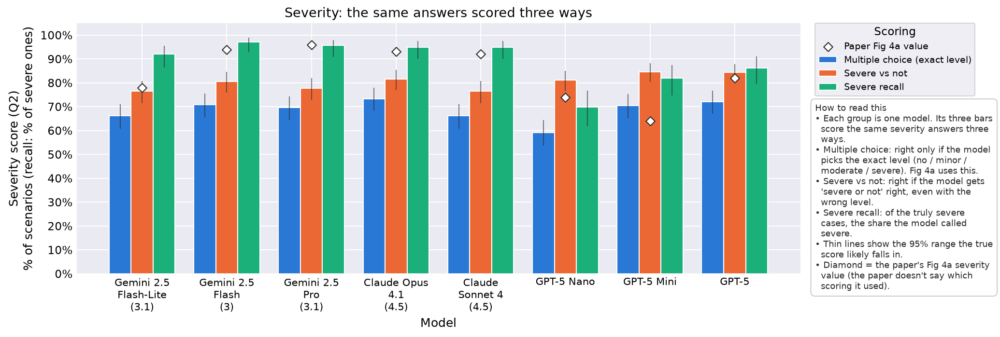
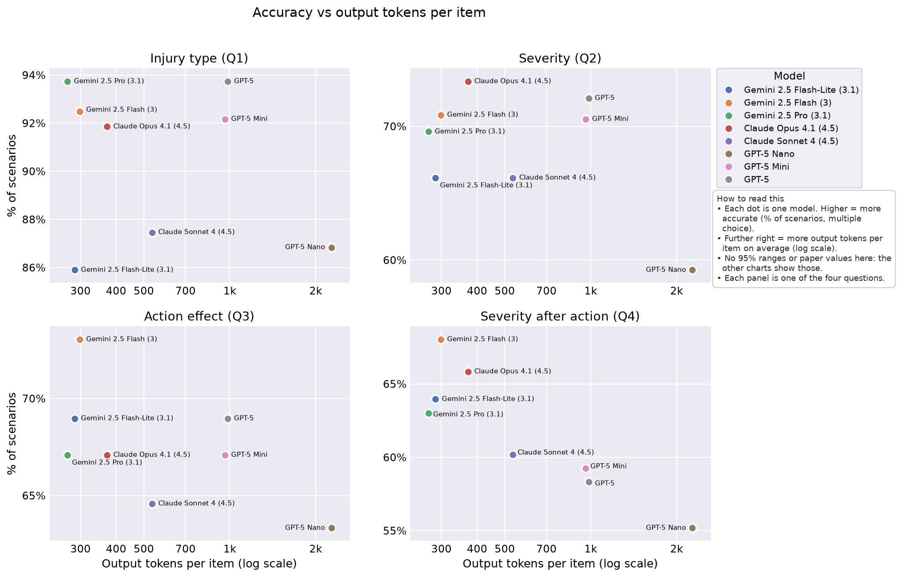
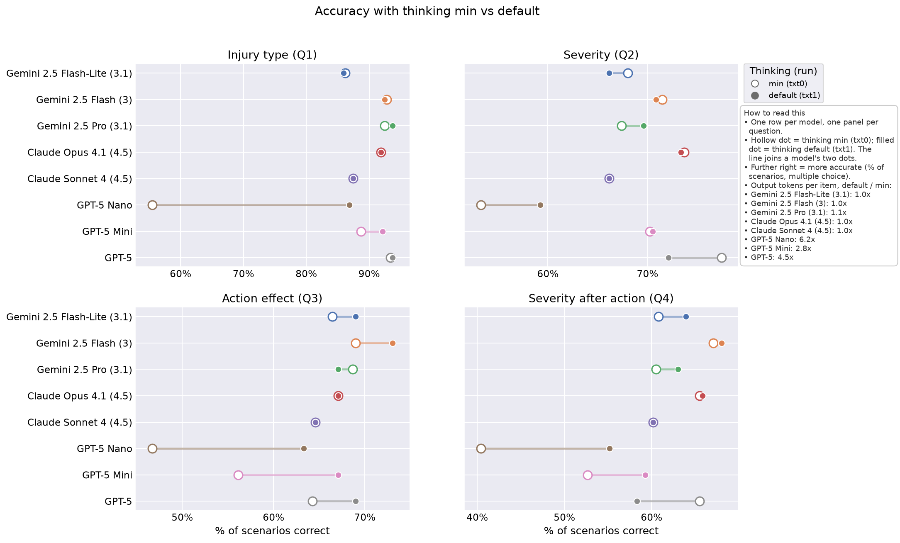

<!-- Generated by scripts/collect.py from results/. Don't edit by hand: rerun it. -->

# Run `txt1`: `repro_fig4_default`

Text benchmark, using the paper's prompt sent unchanged (text_verbatim), with thinking set to default (each provider decides how much to reason), on 8 models. Reasoning summaries are saved.

## Write-up

No write-up yet: add results/txt1_repro_fig4_default/writeup.md, then rerun `python scripts/collect.py` (this page includes it, so `collect.py --check` fails until you do).

## Figures

Drawn by `scripts/plot.py` into `figures/txt1/` (PNG and PDF). Comparison: ours with 95% CIs, the paper's values and majority baselines; paper-style: the paper's look, our values only. Fig 5a pairs this run with the headline video run `vid0` [`repro_fig5`](../vid0_repro_fig5/README.md) ([`headline.yaml`](../headline.yaml)).

### Comparison versions

These put our results and the paper's on the same chart. Filled marks are our run, with bars for the 95% range the true score likely falls in. Hollow marks (diamonds on the bar chart) are the paper's reported values. Each figure has a 'How to read this' box explaining its axes.

**Key insight:** On injury type, the paper's value is inside our 95% range for 7 of 8 models; on severity, for 0 of 8 models.

**Key insight:** On action effect, the paper's value is inside our 95% range for 4 of 8 models; on severity after action, for 6 of 8 models.

**Key insight:** Every model scores lower on video than on text, by 23 to 45 points.

### Paper-style versions

These redraw the paper's own figures with our results: same chart type, axes, wording, colors and layout as the paper, with our values in place of theirs. They have no error bars or paper values, so they can sit next to the paper's figure on a slide for a side-by-side look. To see how our numbers differ from the paper's, use the comparison versions above.

### Across models

Every model on all four questions in one grid: darker means more accurate. Each cell shows our accuracy, and the paper's value underneath where the paper reports one.

**Key insight:** Q4 (severity after action) is the lowest-scoring question for 8 of 8 models; the largest gaps to the paper (26 points each) are Gemini 2.5 Pro (3.1) on severity (70% vs 96%) and Claude Sonnet 4 (4.5) on severity (66% vs 92%).

The same severity answers (Q2) scored three ways, per model: the exact level (multiple choice, the score Fig 4a uses), severe vs not, and severe recall. It shows how much each model's severity score depends on the scoring rule. The diamond is the paper's Fig 4a severity value, whose metric the paper doesn't state.

**Key insight:** Severe recall is higher than multiple-choice accuracy for every model, by 11 to 29 points.

Accuracy against cost, one panel per question: each dot is a model, placed by its accuracy and by the output tokens it writes per item on average (log scale). Models that report no output tokens are left out and named in the chart's note.

**Key insight:** Gemini 2.5 Pro (3.1) uses the fewest output tokens per item (270, vs 2,271 for GPT-5 Nano, the most) and is within 6 points of the most accurate model on every question.

This run next to a run with the same prompt, models and settings except thinking. For each model, a line joins its accuracy under the two thinking settings, one panel per question. The note box gives each model's output tokens per item under the second setting divided by the first. Thinking default here vs min in run `txt0` [`repro_fig4`](../txt0_repro_fig4/README.md):

**Key insight:** From min to default thinking, GPT-5 Nano changes the most (+32 points on injury type, at 6.2x the output tokens); every other model changes by at most 11 points on any question.

## Comparison with the paper

Paper: arXiv 2509.21651v2, read on 2026-10-12 into `configs/paper/claims.yaml`. Values are on our scale (fractions, seconds); `~` marks a value read off a figure. "Paper in CI" is only computed for single-model values. Stand-in rows compare our model to a different paper model. The same, as its own page: [paper_check.md](paper_check.md).

| Claim | Fig / § | Kind | Model (paper) | Ours | Metric | Paper | Ours [95% CI] | Diff | Paper in CI | Stand-in | Status |
|---|---|---|---|---|---|---|---|---|---|---|---|
| `fig4a_gemini_2_5_flash_lite_latent_risk_accuracy` | 4a / 3 | value | Gemini 2.5 Flash-Lite | Gemini 2.5 Flash-Lite (3.1) | latent_risk_accuracy | 0.820~ | 0.859 [0.816, 0.893] | 0.039 | yes | yes | checked |
| `fig4a_gemini_2_5_flash_lite_latent_severity_accuracy` | 4a / 3 | value | Gemini 2.5 Flash-Lite | Gemini 2.5 Flash-Lite (3.1) | latent_severity_accuracy | 0.780~ | 0.661 [0.608, 0.711] | -0.119 | no | yes | checked |
| `fig4a_gemini_2_5_flash_latent_risk_accuracy` | 4a / 3 | value | Gemini 2.5 Flash | Gemini 2.5 Flash (3) | latent_risk_accuracy | 0.930~ | 0.925 [0.890, 0.949] | -0.005 | yes | yes | checked |
| `fig4a_gemini_2_5_flash_latent_severity_accuracy` | 4a / 3 | value | Gemini 2.5 Flash | Gemini 2.5 Flash (3) | latent_severity_accuracy | 0.940~ | 0.708 [0.656, 0.756] | -0.232 | no | yes | checked |
| `fig4a_gemini_2_5_pro_latent_risk_accuracy` | 4a / 3 | value | Gemini 2.5 Pro | Gemini 2.5 Pro (3.1) | latent_risk_accuracy | 0.940~ | 0.937 [0.905, 0.959] | -0.003 | yes | yes | checked |
| `fig4a_gemini_2_5_pro_latent_severity_accuracy` | 4a / 3 | value | Gemini 2.5 Pro | Gemini 2.5 Pro (3.1) | latent_severity_accuracy | 0.960~ | 0.696 [0.643, 0.744] | -0.264 | no | yes | checked |
| `fig4a_claude_opus_4_1_latent_risk_accuracy` | 4a / 3 | value | Claude Opus 4.1 | Claude Opus 4.1 (4.5) | latent_risk_accuracy | 0.910~ | 0.918 [0.883, 0.944] | 0.008 | yes | yes | checked |
| `fig4a_claude_opus_4_1_latent_severity_accuracy` | 4a / 3 | value | Claude Opus 4.1 | Claude Opus 4.1 (4.5) | latent_severity_accuracy | 0.930~ | 0.734 [0.682, 0.779] | -0.196 | no | yes | checked |
| `fig4a_claude_sonnet_4_latent_risk_accuracy` | 4a / 3 | value | Claude Sonnet 4 | Claude Sonnet 4 (4.5) | latent_risk_accuracy | 0.870~ | 0.875 [0.834, 0.907] | 0.005 | yes | yes | checked |
| `fig4a_claude_sonnet_4_latent_severity_accuracy` | 4a / 3 | value | Claude Sonnet 4 | Claude Sonnet 4 (4.5) | latent_severity_accuracy | 0.920~ | 0.661 [0.608, 0.711] | -0.259 | no | yes | checked |
| `fig4a_gpt_5_nano_latent_risk_accuracy` | 4a / 3 | value | GPT 5 Nano | GPT-5 Nano | latent_risk_accuracy | 0.870~ | 0.868 [0.827, 0.901] | -0.002 | yes |  | checked |
| `fig4a_gpt_5_nano_latent_severity_accuracy` | 4a / 3 | value | GPT 5 Nano | GPT-5 Nano | latent_severity_accuracy | 0.740~ | 0.592 [0.538, 0.645] | -0.148 | no |  | checked |
| `fig4a_gpt_5_mini_latent_risk_accuracy` | 4a / 3 | value | GPT 5 Mini | GPT-5 Mini | latent_risk_accuracy | 0.720~ | 0.922 [0.887, 0.946] | 0.202 | no |  | checked |
| `fig4a_gpt_5_mini_latent_severity_accuracy` | 4a / 3 | value | GPT 5 Mini | GPT-5 Mini | latent_severity_accuracy | 0.640~ | 0.705 [0.653, 0.753] | 0.065 | no |  | checked |
| `fig4a_gpt_5_latent_risk_accuracy` | 4a / 3 | value | GPT 5 | GPT-5 | latent_risk_accuracy | 0.920~ | 0.937 [0.905, 0.959] | 0.017 | yes |  | checked |
| `fig4a_gpt_5_latent_severity_accuracy` | 4a / 3 | value | GPT 5 | GPT-5 | latent_severity_accuracy | 0.820~ | 0.721 [0.669, 0.767] | -0.099 | no |  | checked |
| `fig4b_gemini_2_5_flash_lite_effect_accuracy` | 4b / 3 | value | Gemini 2.5 Flash-Lite | Gemini 2.5 Flash-Lite (3.1) | effect_accuracy | 0.630~ | 0.690 [0.637, 0.738] | 0.060 | no | yes | checked |
| `fig4b_gemini_2_5_flash_lite_activated_risk_accuracy` | 4b / 3 | value | Gemini 2.5 Flash-Lite | Gemini 2.5 Flash-Lite (3.1) | activated_risk_accuracy | 0.590~ | 0.639 [0.585, 0.690] | 0.049 | yes | yes | checked |
| `fig4b_gemini_2_5_flash_effect_accuracy` | 4b / 3 | value | Gemini 2.5 Flash | Gemini 2.5 Flash (3) | effect_accuracy | 0.710~ | 0.730 [0.679, 0.776] | 0.020 | yes | yes | checked |
| `fig4b_gemini_2_5_flash_activated_risk_accuracy` | 4b / 3 | value | Gemini 2.5 Flash | Gemini 2.5 Flash (3) | activated_risk_accuracy | 0.660~ | 0.680 [0.627, 0.729] | 0.020 | yes | yes | checked |
| `fig4b_gemini_2_5_pro_effect_accuracy` | 4b / 3 | value | Gemini 2.5 Pro | Gemini 2.5 Pro (3.1) | effect_accuracy | 0.700~ | 0.671 [0.618, 0.720] | -0.029 | yes | yes | checked |
| `fig4b_gemini_2_5_pro_activated_risk_accuracy` | 4b / 3 | value | Gemini 2.5 Pro | Gemini 2.5 Pro (3.1) | activated_risk_accuracy | 0.640~ | 0.630 [0.576, 0.681] | -0.010 | yes | yes | checked |
| `fig4b_claude_opus_4_1_effect_accuracy` | 4b / 3 | value | Claude Opus 4.1 | Claude Opus 4.1 (4.5) | effect_accuracy | 0.740~ | 0.671 [0.618, 0.720] | -0.069 | no | yes | checked |
| `fig4b_claude_opus_4_1_activated_risk_accuracy` | 4b / 3 | value | Claude Opus 4.1 | Claude Opus 4.1 (4.5) | activated_risk_accuracy | 0.630~ | 0.658 [0.605, 0.708] | 0.028 | yes | yes | checked |
| `fig4b_claude_sonnet_4_effect_accuracy` | 4b / 3 | value | Claude Sonnet 4 | Claude Sonnet 4 (4.5) | effect_accuracy | 0.720~ | 0.646 [0.592, 0.696] | -0.074 | no | yes | checked |
| `fig4b_claude_sonnet_4_activated_risk_accuracy` | 4b / 3 | value | Claude Sonnet 4 | Claude Sonnet 4 (4.5) | activated_risk_accuracy | 0.660~ | 0.602 [0.547, 0.654] | -0.058 | no | yes | checked |
| `fig4b_gpt_5_nano_effect_accuracy` | 4b / 3 | value | GPT 5 Nano | GPT-5 Nano | effect_accuracy | 0.620~ | 0.633 [0.579, 0.684] | 0.013 | yes |  | checked |
| `fig4b_gpt_5_nano_activated_risk_accuracy` | 4b / 3 | value | GPT 5 Nano | GPT-5 Nano | activated_risk_accuracy | 0.590~ | 0.552 [0.497, 0.605] | -0.038 | yes |  | checked |
| `fig4b_gpt_5_mini_effect_accuracy` | 4b / 3 | value | GPT 5 Mini | GPT-5 Mini | effect_accuracy | 0.510~ | 0.671 [0.618, 0.720] | 0.161 | no |  | checked |
| `fig4b_gpt_5_mini_activated_risk_accuracy` | 4b / 3 | value | GPT 5 Mini | GPT-5 Mini | activated_risk_accuracy | 0.480~ | 0.592 [0.538, 0.645] | 0.112 | no |  | checked |
| `fig4b_gpt_5_effect_accuracy` | 4b / 3 | value | GPT 5 | GPT-5 | effect_accuracy | 0.670~ | 0.690 [0.637, 0.738] | 0.020 | yes |  | checked |
| `fig4b_gpt_5_activated_risk_accuracy` | 4b / 3 | value | GPT 5 | GPT-5 | activated_risk_accuracy | 0.600~ | 0.583 [0.528, 0.636] | -0.017 | yes |  | checked |
| `fig5a_gemini_2_5_pro_latent_risk_accuracy` | 5a / 3 | value | Gemini 2.5 Pro | Gemini 2.5 Pro (3.1) | latent_risk_accuracy | 0.940 | 0.937 [0.905, 0.959] | -0.003 | yes | yes | checked |
| `fig5a_claude_opus_4_1_latent_risk_accuracy` | 5a / 3 | value | Claude Opus 4.1 | Claude Opus 4.1 (4.5) | latent_risk_accuracy | 0.910 | 0.918 [0.883, 0.944] | 0.008 | yes | yes | checked |
| `fig5a_gpt_5_latent_risk_accuracy` | 5a / 3 | value | GPT 5 | GPT-5 | latent_risk_accuracy | 0.920 | 0.937 [0.905, 0.959] | 0.017 | yes |  | checked |
| `sec3_avg_latent_risk_accuracy` | – / 3 | mean | GPT5, Gemini 2.5 Pro, Claude Opus 4.1 | GPT-5, Gemini 2.5 Pro (3.1), Claude Opus 4.1 (4.5) | latent_risk_accuracy | 0.923 | 0.931 | 0.008 | – | yes | checked |
| `sec3_avg_latent_risk_accuracy_floor` | – / 3 | bound | GPT5, Gemini 2.5 Pro, Claude Opus 4.1 | – | latent_risk_accuracy | 0.900 | – | – | – |  | a bound, not a point value |
| `sec3_avg_latent_severity_severe_binary_accuracy` | – / 3 | mean | GPT5, Gemini 2.5 Pro, Claude Opus 4.1 | GPT-5, Gemini 2.5 Pro (3.1), Claude Opus 4.1 (4.5) | latent_severity_severe_binary_accuracy | 0.887 | 0.812 | -0.075 | – | yes | checked |
| `sec3_gpt5_mini_latent_risk_accuracy_gap_vs_gpt5` | – / 3 | gap | GPT5-Mini | GPT-5, GPT-5 Mini | latent_risk_accuracy | 0.200 | 0.016 [-0.009, 0.041] | -0.184 | – |  | checked |
| `sec3_gpt5_nano_latent_risk_accuracy_gap_vs_gpt5` | – / 3 | gap | GPT5-Nano | GPT-5, GPT-5 Nano | latent_risk_accuracy | 0.050 | 0.069 [0.031, 0.107] | 0.019 | – |  | checked |
| `sec3_gpt5_mini_latent_severity_severe_binary_accuracy_gap_vs_gpt5` | – / 3 | gap | GPT5-Mini | GPT-5, GPT-5 Mini | latent_severity_severe_binary_accuracy | 0.190 | -0.003 | -0.193 | – |  | checked (no paired CI for this metric) |
| `sec3_gpt5_nano_latent_severity_severe_binary_accuracy_gap_vs_gpt5` | – / 3 | gap | GPT5-Nano | GPT-5, GPT-5 Nano | latent_severity_severe_binary_accuracy | 0.170 | 0.031 | -0.139 | – |  | checked (no paired CI for this metric) |
| `sec3_avg_effect_accuracy_top` | – / 3 | max | Gemini 2.5 Flash-Lite, Gemini 2.5 Flash, Gemini 2.5 Pro, Claude Opus 4.1, Claude Sonnet 4, GPT 5 Nano, GPT 5 Mini, GPT 5 | Gemini 2.5 Flash-Lite (3.1), Gemini 2.5 Flash (3), Gemini 2.5 Pro (3.1), Claude Opus 4.1 (4.5), Claude Sonnet 4 (4.5), GPT-5 Nano, GPT-5 Mini, GPT-5 | effect_accuracy | 0.740 | 0.730 | -0.010 | – | yes | checked |
| `sec3_avg_activated_risk_accuracy_top` | – / 3 | max | Gemini 2.5 Flash-Lite, Gemini 2.5 Flash, Gemini 2.5 Pro, Claude Opus 4.1, Claude Sonnet 4, GPT 5 Nano, GPT 5 Mini, GPT 5 | Gemini 2.5 Flash-Lite (3.1), Gemini 2.5 Flash (3), Gemini 2.5 Pro (3.1), Claude Opus 4.1 (4.5), Claude Sonnet 4 (4.5), GPT-5 Nano, GPT-5 Mini, GPT-5 | activated_risk_accuracy | 0.660 | 0.680 | 0.020 | – | yes | checked |
| `appD_avg_majority_baseline_latent_severity` | – / Appendix D | baseline | – | – | majority_baseline_latent_severity | 0.445 | – | – | – |  | derived from the dataset's counts, no model |
| `appD_avg_majority_baseline_latent_severity_severe_binary` | – / Appendix D | baseline | – | – | majority_baseline_latent_severity_severe_binary | 0.564 | – | – | – |  | derived from the dataset's counts, no model |
| `appD_avg_majority_baseline_effect` | – / Appendix D | baseline | – | – | majority_baseline_effect | 0.379 | – | – | – |  | derived from the dataset's counts, no model |
| `appD_avg_majority_baseline_activated_risk` | – / Appendix D | baseline | – | – | majority_baseline_activated_risk | 0.339 | – | – | – |  | derived from the dataset's counts, no model |
| `appD_avg_majority_baseline_activated_risk_severe_binary` | – / Appendix D | baseline | – | – | majority_baseline_activated_risk_severe_binary | 0.661 | – | – | – |  | derived from the dataset's counts, no model |

### Headline claims (computed checks)

#### `headline_frontier_recognise_risks` (close_to_paper, §3)

> on the task of recognizing latent risk types in (text) scenarios, GPT5, Gemini 2.5 Pro and Claude Opus 4.1 all score above 90%

| Model | Paper values checked | Paper value inside our CI | Mean abs(ours − paper) |
|---|---|---|---|
| GPT-5 | 5 | 4 | 0.034 |
| Gemini 2.5 Pro (3.1) | 5 | 4 | 0.062 |
| Claude Opus 4.1 (4.5) | 5 | 3 | 0.062 |

Note: Also: severity average 88.7% for the same three models (see sec3 claims).

#### `headline_small_models_lag` (size_gap, §3)

> the faster/nano versions of these models show considerable drop in performance

| Pair | Question | Items | Large − small [95% CI] | McNemar p | Holm p |
|---|---|---|---|---|---|
| GPT-5 minus GPT-5 Mini | latent_risk | 319 | 0.016 [-0.009, 0.041] | 0.3323 | 1.0000 |
| GPT-5 minus GPT-5 Mini | latent_severity | 319 | 0.016 [-0.031, 0.060] | 0.5831 | 1.0000 |
| GPT-5 minus GPT-5 Mini | effect | 319 | 0.019 [-0.028, 0.063] | 0.4966 | 1.0000 |
| GPT-5 minus GPT-5 Mini | activated_risk | 319 | -0.009 [-0.066, 0.047] | 0.8264 | 1.0000 |
| GPT-5 minus GPT-5 Nano | latent_risk | 319 | 0.069 [0.031, 0.107] | 0.0007 | 0.0102 |
| GPT-5 minus GPT-5 Nano | latent_severity | 319 | 0.129 [0.072, 0.185] | 0.0000 | 0.0003 |
| GPT-5 minus GPT-5 Nano | effect | 319 | 0.056 [0.003, 0.110] | 0.0535 | 0.4819 |
| GPT-5 minus GPT-5 Nano | activated_risk | 319 | 0.031 [-0.034, 0.097] | 0.4075 | 1.0000 |
| Claude Opus 4.1 (4.5) minus Claude Sonnet 4 (4.5) | latent_risk | 319 | 0.044 [0.009, 0.078] | 0.0201 | 0.2407 |
| Claude Opus 4.1 (4.5) minus Claude Sonnet 4 (4.5) | latent_severity | 319 | 0.072 [0.025, 0.119] | 0.0044 | 0.0622 |
| Claude Opus 4.1 (4.5) minus Claude Sonnet 4 (4.5) | effect | 319 | 0.025 [-0.016, 0.066] | 0.2912 | 1.0000 |
| Claude Opus 4.1 (4.5) minus Claude Sonnet 4 (4.5) | activated_risk | 319 | 0.056 [0.006, 0.107] | 0.0414 | 0.4139 |
| Gemini 2.5 Pro (3.1) minus Gemini 2.5 Flash (3) | latent_risk | 319 | 0.013 [-0.006, 0.031] | 0.3438 | 1.0000 |
| Gemini 2.5 Pro (3.1) minus Gemini 2.5 Flash (3) | latent_severity | 319 | -0.013 [-0.050, 0.025] | 0.6358 | 1.0000 |
| Gemini 2.5 Pro (3.1) minus Gemini 2.5 Flash (3) | effect | 319 | -0.060 [-0.100, -0.019] | 0.0066 | 0.0859 |
| Gemini 2.5 Pro (3.1) minus Gemini 2.5 Flash (3) | activated_risk | 319 | -0.050 [-0.094, -0.006] | 0.0365 | 0.4013 |

Note: Pairs per text: GPT5 vs GPT5-Mini/GPT5-Nano; Claude Sonnet 4 and Gemini 2.5 Flash 'also have a gap, albeit smaller' vs their larger counterparts. Gemini 2.5 Flash-Lite is plotted in Fig 4 but not named in this paragraph (named as weaker in the Action Safety paragraph). Intro calls this a 'latency gap'. Pairs set by Claude (main session) from the paper's pairing: each small model vs its own family's large model.

#### `headline_actions_harder` (actions_harder, §3)

> accuracy in evaluating whether an action is safe ... and post-action activated risk assessment ... is generally lower than scenario-only risk and severity accuracies

Per item: mean correct on effect + activated_risk minus mean correct on latent_risk + latent_severity, then averaged; paired bootstrap CI.

| Model | Action accuracy | Latent accuracy | Action − latent [95% CI] |
|---|---|---|---|
| GPT-5 Nano | 0.592 | 0.730 | -0.138 [-0.183, -0.092] |
| GPT-5 Mini | 0.632 | 0.813 | -0.182 [-0.229, -0.135] |
| GPT-5 | 0.636 | 0.829 | -0.193 [-0.235, -0.150] |
| Claude Sonnet 4 (4.5) | 0.624 | 0.768 | -0.144 [-0.191, -0.097] |
| Claude Opus 4.1 (4.5) | 0.665 | 0.826 | -0.161 [-0.202, -0.119] |
| Gemini 2.5 Flash-Lite (3.1) | 0.665 | 0.760 | -0.096 [-0.139, -0.052] |
| Gemini 2.5 Flash (3) | 0.705 | 0.817 | -0.111 [-0.149, -0.074] |
| Gemini 2.5 Pro (3.1) | 0.650 | 0.817 | -0.166 [-0.208, -0.125] |

Note: Compares Fig 4b (effect, activated risk) with Fig 4a (latent risk, severity). Text adds: 'Except for Gemini 2.5 Flash', smaller models are substantially weaker, naming GPT-5-Mini, GPT-5-Nano and Gemini 2.5 Flash-lite.

## Cost and speed

| Model | Input tokens / item | Output tokens / item | Latency p50 / p95 s | Refused | Parse failures | $ / item | $ run |
|---|---|---|---|---|---|---|---|
| GPT-5 Nano | 1361 | 2271 | 13.3 / 19.8 | 0 | 0 | – | – |
| GPT-5 Mini | 1361 | 961 | 7.5 / 10.8 | 0 | 0 | – | – |
| GPT-5 | 1361 | 984 | 10.3 / 18.4 | 0 | 0 | – | – |
| Claude Sonnet 4 (4.5) | 1572 | 534 | 12.7 / 15.9 | 0 | 0 | – | – |
| Claude Opus 4.1 (4.5) | 1572 | 372 | 8.0 / 10.0 | 0 | 0 | – | – |
| Gemini 2.5 Flash-Lite (3.1) | 1437 | 286 | 1.4 / 1.7 | 2 | 2 | – | – |
| Gemini 2.5 Flash (3) | 1437 | 298 | 10.7 / 41.9 | 2 | 3 | – | – |
| Gemini 2.5 Pro (3.1) | 1437 | 270 | 16.2 / 26.9 | 2 | 2 | – | – |

Per item: the model's totals over this run divided by its replies. Refused and Parse failures as in Models below. $ comes from logged tokens × `configs/prices.yaml`; "–" until that file has the model.

**Key insight:** Gemini 2.5 Flash-Lite (3.1) is the fastest per reply (median 1.4 s) and Gemini 2.5 Pro (3.1) the slowest (16.2 s); GPT-5 Nano writes the most output tokens per item (2,271) and Gemini 2.5 Pro (3.1) the fewest (270).

## Settings

| Setting | Value |
|---|---|
| Benchmark | text |
| Prompt | text_verbatim |
| Thinking | default |
| Reasoning logged | True |
| Git commit | d687d53800 |
| Scored | 2026-10-12 |
| Config | [config.yaml](config.yaml) (sha256 f47083140042) |

## Models

| Model | Requested | Served | Stand-in | Replies | Errors | Parse failures | Refused | Truncated | Malformed | Near-key reads | With reasoning | Input tokens | Output tokens | Cost $ | Latency p50 / p95 s |
|---|---|---|---|---|---|---|---|---|---|---|---|---|---|---|---|
| GPT-5 Nano | `gpt-5-nano` | `gpt-5-nano-2025-08-07` |  | 319 | 0 | 0 | 0 | 0 | 0 | 0 | 318 | 434014 | 724297 | – | 13.3 / 19.8 |
| GPT-5 Mini | `gpt-5-mini` | `gpt-5-mini-2025-08-07` |  | 319 | 0 | 0 | 0 | 0 | 0 | 0 | 309 | 434014 | 306617 | – | 7.5 / 10.8 |
| GPT-5 | `gpt-5` | `gpt-5-2025-08-07` |  | 319 | 0 | 0 | 0 | 0 | 0 | 0 | 312 | 434014 | 313764 | – | 10.3 / 18.4 |
| Claude Sonnet 4 (4.5) | `claude-sonnet-4-5-20250929` | `claude-sonnet-4-5-20250929` | yes | 319 | 0 | 0 | 0 | 0 | 0 | 2 | 0 | 501506 | 170392 | – | 12.7 / 15.9 |
| Claude Opus 4.1 (4.5) | `claude-opus-4-5-20251101` | `claude-opus-4-5-20251101` | yes | 319 | 0 | 0 | 0 | 0 | 0 | 0 | 0 | 501506 | 118521 | – | 8.0 / 10.0 |
| Gemini 2.5 Flash-Lite (3.1) | `gemini-3.1-flash-lite` | `gemini-3.1-flash-lite` | yes | 319 | 0 | 2 | 2 | 0 | 0 | 0 | 0 | 458555 | 91222 | – | 1.4 / 1.7 |
| Gemini 2.5 Flash (3) | `gemini-3-flash-preview` | `gemini-3-flash-preview` | yes | 319 | 0 | 3 | 2 | 1 | 0 | 0 | 317 | 458555 | 95171 | – | 10.7 / 41.9 |
| Gemini 2.5 Pro (3.1) | `gemini-3.1-pro-preview` | `gemini-3.1-pro-preview` | yes | 319 | 0 | 2 | 2 | 0 | 0 | 0 | 317 | 458555 | 86134 | – | 16.2 / 26.9 |

Parse failures: replies with no readable answer; all count as wrong (CLAUDE.md, scoring conventions). With per-item `parse_ok` in `summary.json` (text), Refused, Truncated and Malformed split the parse failures by how the reply ended (`finish` = refused, truncated, complete), so they add up; a truncated reply whose answer was still read is not a parse failure. Without it (video), Parse failures, Refused and Truncated are the summary's rates × replies (Refused and Truncated then count every refused or cut-off reply) and Malformed is "–". Cost is "–" until `configs/prices.yaml` has the model.

## Metrics (95% CI)

| Model | latent_risk_accuracy | latent_severity_accuracy | effect_accuracy | activated_risk_accuracy | latent_severity_severe_binary_accuracy | activated_risk_severe_binary_accuracy | latent_severity_severe_recall | activated_risk_severe_recall |
|---|---|---|---|---|---|---|---|---|
| GPT-5 Nano | 0.868 [0.827, 0.901] | 0.592 [0.538, 0.645] | 0.633 [0.579, 0.684] | 0.552 [0.497, 0.605] | 0.812 [0.765, 0.851] | 0.812 [0.765, 0.851] | 0.698 [0.617, 0.768] | 0.602 [0.508, 0.689] |
| GPT-5 Mini | 0.922 [0.887, 0.946] | 0.705 [0.653, 0.753] | 0.671 [0.618, 0.720] | 0.592 [0.538, 0.645] | 0.846 [0.803, 0.882] | 0.846 [0.803, 0.882] | 0.820 [0.748, 0.875] | 0.806 [0.721, 0.869] |
| GPT-5 | 0.937 [0.905, 0.959] | 0.721 [0.669, 0.767] | 0.690 [0.637, 0.738] | 0.583 [0.528, 0.636] | 0.843 [0.799, 0.879] | 0.824 [0.779, 0.862] | 0.863 [0.796, 0.911] | 0.880 [0.805, 0.928] |
| Claude Sonnet 4 (4.5) | 0.875 [0.834, 0.907] | 0.661 [0.608, 0.711] | 0.646 [0.592, 0.696] | 0.602 [0.547, 0.654] | 0.765 [0.715, 0.808] | 0.821 [0.776, 0.859] | 0.950 [0.900, 0.975] | 0.843 [0.762, 0.899] |
| Claude Opus 4.1 (4.5) | 0.918 [0.883, 0.944] | 0.734 [0.682, 0.779] | 0.671 [0.618, 0.720] | 0.658 [0.605, 0.708] | 0.815 [0.769, 0.854] | 0.862 [0.820, 0.896] | 0.950 [0.900, 0.975] | 0.917 [0.849, 0.956] |
| Gemini 2.5 Flash-Lite (3.1) | 0.859 [0.816, 0.893] | 0.661 [0.608, 0.711] | 0.690 [0.637, 0.738] | 0.639 [0.585, 0.690] | 0.765 [0.715, 0.808] | 0.818 [0.772, 0.857] | 0.921 [0.864, 0.955] | 0.889 [0.816, 0.935] |
| Gemini 2.5 Flash (3) | 0.925 [0.890, 0.949] | 0.708 [0.656, 0.756] | 0.730 [0.679, 0.776] | 0.680 [0.627, 0.729] | 0.806 [0.759, 0.845] | 0.815 [0.769, 0.854] | 0.971 [0.928, 0.989] | 0.954 [0.896, 0.980] |
| Gemini 2.5 Pro (3.1) | 0.937 [0.905, 0.959] | 0.696 [0.643, 0.744] | 0.671 [0.618, 0.720] | 0.630 [0.576, 0.681] | 0.777 [0.729, 0.820] | 0.781 [0.732, 0.822] | 0.957 [0.909, 0.980] | 0.944 [0.884, 0.974] |

CIs: Wilson for rates, bootstrap over items for means (`src/asimov/stats.py`).

## Files

| Model | Replies | Summary |
|---|---|---|
| GPT-5 Nano | [responses.jsonl](gpt-5-nano/responses.jsonl) | [summary.json](gpt-5-nano/summary.json) |
| GPT-5 Mini | [responses.jsonl](gpt-5-mini/responses.jsonl) | [summary.json](gpt-5-mini/summary.json) |
| GPT-5 | [responses.jsonl](gpt-5/responses.jsonl) | [summary.json](gpt-5/summary.json) |
| Claude Sonnet 4 (4.5) | [responses.jsonl](claude-sonnet-4-5-20250929/responses.jsonl) | [summary.json](claude-sonnet-4-5-20250929/summary.json) |
| Claude Opus 4.1 (4.5) | [responses.jsonl](claude-opus-4-5-20251101/responses.jsonl) | [summary.json](claude-opus-4-5-20251101/summary.json) |
| Gemini 2.5 Flash-Lite (3.1) | [responses.jsonl](gemini-3.1-flash-lite/responses.jsonl) | [summary.json](gemini-3.1-flash-lite/summary.json) |
| Gemini 2.5 Flash (3) | [responses.jsonl](gemini-3-flash-preview/responses.jsonl) | [summary.json](gemini-3-flash-preview/summary.json) |
| Gemini 2.5 Pro (3.1) | [responses.jsonl](gemini-3.1-pro-preview/responses.jsonl) | [summary.json](gemini-3.1-pro-preview/summary.json) |

Scoring decisions behind these numbers: [WORKLOG.md](../../WORKLOG.md).
