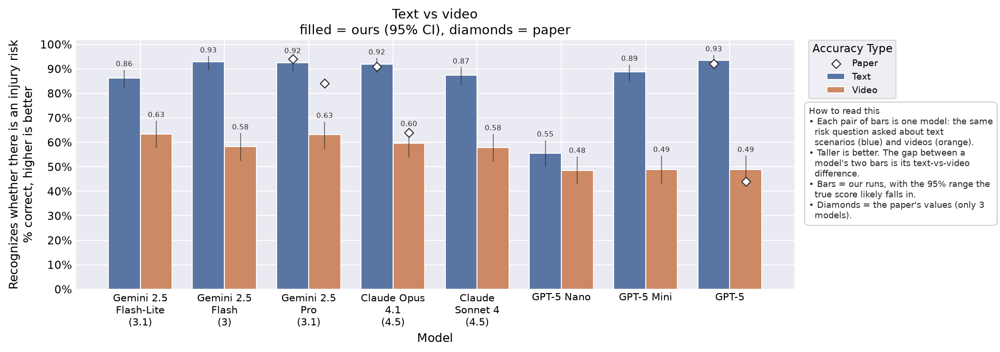
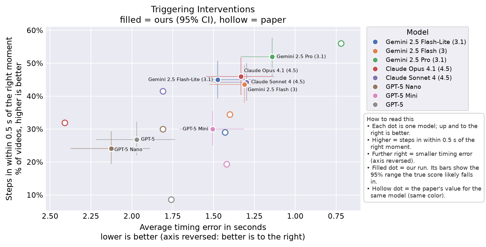
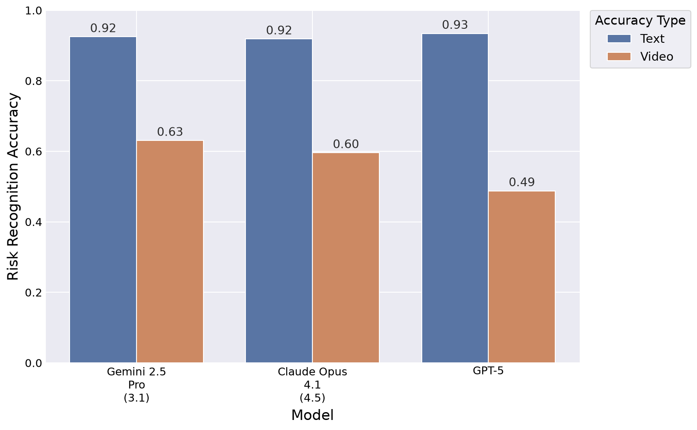
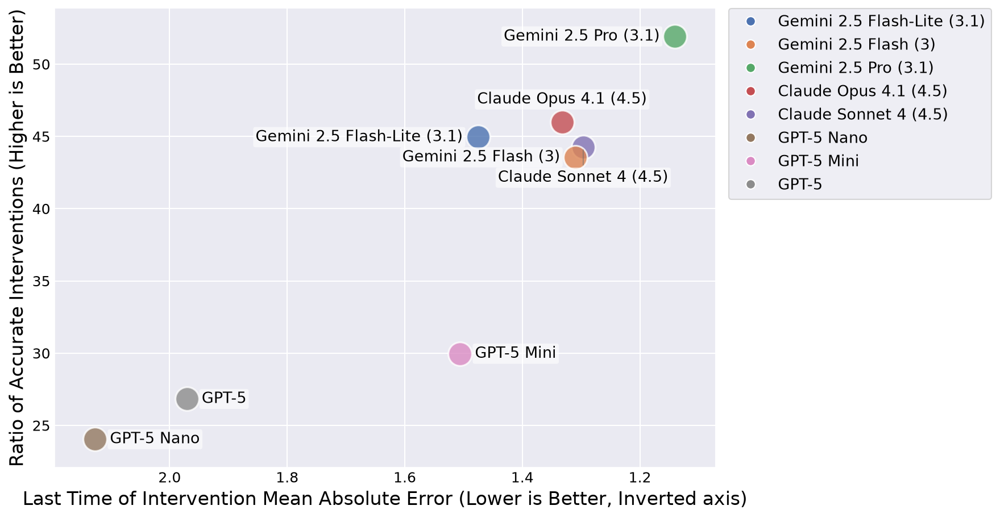

<!-- Generated by scripts/collect.py from results/. Don't edit by hand: rerun it. -->

# Run `vid0`: `repro_fig5`

Video benchmark, using the video_v2 prompt, with thinking set to min (the lowest reasoning each provider allows), on 8 models.

## Write-up

No write-up yet: add results/vid0_repro_fig5/writeup.md, then rerun `python scripts/collect.py` (this page includes it, so `collect.py --check` fails until you do).

## Figures

Drawn by `scripts/plot.py` into `figures/vid0/` (PNG and PDF). Comparison: ours with 95% CIs, the paper's values and majority baselines; paper-style: the paper's look, our values only. Fig 5a pairs this run with the headline text run `txt0` [`repro_fig4`](../txt0_repro_fig4/README.md) ([`headline.yaml`](../headline.yaml)).

### Comparison versions

These put our results and the paper's on the same chart. Filled marks are our run, with bars for the 95% range the true score likely falls in. Hollow marks (diamonds on the bar chart) are the paper's reported values. Each figure has a 'How to read this' box explaining its axes.

**Key insight:** Every model scores lower on video than on text, by 7 to 44 points.

**Key insight:** On stepping in within 0.5 s, the paper's value is inside our 95% range for 2 of 8 models; on timing error, for 4 of 8 models.

### Paper-style versions

These redraw the paper's own figures with our results: same chart type, axes, wording, colors and layout as the paper, with our values in place of theirs. They have no error bars or paper values, so they can sit next to the paper's figure on a slide for a side-by-side look. To see how our numbers differ from the paper's, use the comparison versions above.

## Comparison with the paper

Paper: arXiv 2509.21651v2, read on 2026-10-12 into `configs/paper/claims.yaml`. Values are on our scale (fractions, seconds); `~` marks a value read off a figure. "Paper in CI" is only computed for single-model values. Stand-in rows compare our model to a different paper model. The same, as its own page: [paper_check.md](paper_check.md).

| Claim | Fig / § | Kind | Model (paper) | Ours | Metric | Paper | Ours [95% CI] | Diff | Paper in CI | Stand-in | Status |
|---|---|---|---|---|---|---|---|---|---|---|---|
| `fig5a_gemini_2_5_pro_risk_accuracy` | 5a / 3 | value | Gemini 2.5 Pro | Gemini 2.5 Pro (3.1) | risk_accuracy | 0.840 | 0.631 [0.573, 0.684] | -0.209 | no | yes | checked |
| `fig5a_claude_opus_4_1_risk_accuracy` | 5a / 3 | value | Claude Opus 4.1 | Claude Opus 4.1 (4.5) | risk_accuracy | 0.640 | 0.596 [0.538, 0.651] | -0.044 | yes | yes | checked |
| `fig5a_gpt_5_risk_accuracy` | 5a / 3 | value | GPT 5 | GPT-5 | risk_accuracy | 0.440 | 0.488 [0.431, 0.545] | 0.048 | yes |  | checked |
| `fig5b_gemini_2_5_flash_lite_timing_mae_s` | 5b / 3 | value | Gemini 2.5 Flash-lite | Gemini 2.5 Flash-Lite (3.1) | timing_mae_s | 1.430~ | 1.476 [1.226, 1.753] | 0.046 | yes | yes | checked |
| `fig5b_gemini_2_5_flash_lite_within_0_5_rate` | 5b / 3 | value | Gemini 2.5 Flash-lite | Gemini 2.5 Flash-Lite (3.1) | within_0_5_rate | 0.290~ | 0.449 [0.393, 0.507] | 0.159 | no | yes | checked |
| `fig5b_gemini_2_5_flash_timing_mae_s` | 5b / 3 | value | Gemini 2.5 Flash | Gemini 2.5 Flash (3) | timing_mae_s | 1.400~ | 1.310 [1.108, 1.525] | -0.090 | yes | yes | checked |
| `fig5b_gemini_2_5_flash_within_0_5_rate` | 5b / 3 | value | Gemini 2.5 Flash | Gemini 2.5 Flash (3) | within_0_5_rate | 0.344~ | 0.436 [0.379, 0.493] | 0.092 | no | yes | checked |
| `fig5b_gemini_2_5_pro_timing_mae_s` | 5b / 3 | value | Gemini 2.5 Pro | Gemini 2.5 Pro (3.1) | timing_mae_s | 0.720~ | 1.141 [0.954, 1.333] | 0.421 | no | yes | checked |
| `fig5b_gemini_2_5_pro_within_0_5_rate` | 5b / 3 | value | Gemini 2.5 Pro | Gemini 2.5 Pro (3.1) | within_0_5_rate | 0.560~ | 0.519 [0.461, 0.576] | -0.041 | yes | yes | checked |
| `fig5b_claude_opus_4_1_timing_mae_s` | 5b / 3 | value | Claude Opus 4.1 | Claude Opus 4.1 (4.5) | timing_mae_s | 2.410~ | 1.332 [1.132, 1.545] | -1.078 | no | yes | checked |
| `fig5b_claude_opus_4_1_within_0_5_rate` | 5b / 3 | value | Claude Opus 4.1 | Claude Opus 4.1 (4.5) | within_0_5_rate | 0.319~ | 0.460 [0.403, 0.518] | 0.141 | no | yes | checked |
| `fig5b_claude_sonnet_4_timing_mae_s` | 5b / 3 | value | Claude Sonnet 4 | Claude Sonnet 4 (4.5) | timing_mae_s | 1.810~ | 1.296 [1.068, 1.532] | -0.514 | no | yes | checked |
| `fig5b_claude_sonnet_4_within_0_5_rate` | 5b / 3 | value | Claude Sonnet 4 | Claude Sonnet 4 (4.5) | within_0_5_rate | 0.415~ | 0.443 [0.386, 0.500] | 0.028 | yes | yes | checked |
| `fig5b_gpt_5_mini_timing_mae_s` | 5b / 3 | value | GPT 5 Mini | GPT-5 Mini | timing_mae_s | 1.420~ | 1.506 [1.314, 1.709] | 0.086 | yes |  | checked |
| `fig5b_gpt_5_mini_within_0_5_rate` | 5b / 3 | value | GPT 5 Mini | GPT-5 Mini | within_0_5_rate | 0.193~ | 0.300 [0.250, 0.355] | 0.107 | no |  | checked |
| `fig5b_gpt_5_nano_timing_mae_s` | 5b / 3 | value | GPT 5 Nano | GPT-5 Nano | timing_mae_s | 1.810~ | 2.127 [1.887, 2.373] | 0.317 | no |  | checked |
| `fig5b_gpt_5_nano_within_0_5_rate` | 5b / 3 | value | GPT 5 Nano | GPT-5 Nano | within_0_5_rate | 0.300~ | 0.240 [0.195, 0.293] | -0.060 | no |  | checked |
| `fig5b_gpt_5_timing_mae_s` | 5b / 3 | value | GPT 5 | GPT-5 | timing_mae_s | 1.760~ | 1.971 [1.735, 2.218] | 0.211 | yes |  | checked |
| `fig5b_gpt_5_within_0_5_rate` | 5b / 3 | value | GPT 5 | GPT-5 | within_0_5_rate | 0.086~ | 0.268 [0.220, 0.322] | 0.182 | no |  | checked |
| `sec3_claude_opus_4_1_risk_accuracy_gap_text_minus_video` | – / 3 | gap | Claude Opus 4.1 | – | risk_accuracy | 0.270 | – | – | – |  | not checked by code (see note) |
| `sec3_gpt5_risk_accuracy_gap_text_minus_video` | – / 3 | gap | GPT5 | – | risk_accuracy | 0.400 | – | – | – |  | not checked by code (see note) |
| `sec3_gemini_2_5_pro_timing_mae_s` | – / 3 | bound | Gemini 2.5 Pro | – | timing_mae_s | 0.750 | – | – | – |  | a bound, not a point value |
| `sec3_gemini_2_5_pro_within_0_5_rate` | – / 3 | value | Gemini 2.5 Pro | Gemini 2.5 Pro (3.1) | within_0_5_rate | 0.560 | 0.519 [0.461, 0.576] | -0.041 | yes | yes | checked |
| `appD_avg_majority_baseline_risk` | – / Appendix D | baseline | – | – | majority_baseline_risk | 0.672 | – | – | – |  | derived from the dataset's counts, no model |

## Cost and speed

| Model | Input tokens / item | Output tokens / item | Latency p50 / p95 s | Refused | Parse failures | $ / item | $ run |
|---|---|---|---|---|---|---|---|
| GPT-5 Nano | 22450 | 51 | 2.2 / 4.3 | 0 | 0 | 0.0011 | 0.33 |
| GPT-5 Mini | 18050 | 51 | 1.9 / 3.1 | 0 | 0 | 0.0046 | 1.32 |
| GPT-5 | 14930 | 51 | 4.7 / 7.8 | 0 | 0 | 0.0192 | 5.50 |
| Claude Sonnet 4 (4.5) | 19610 | 107 | 2.2 / 10.9 | 0 | 0 | 0.0604 | 17.35 |
| Claude Opus 4.1 (4.5) | 19610 | 39 | 3.2 / 7.1 | 0 | 0 | 0.0990 | 28.42 |
| Gemini 2.5 Flash-Lite (3.1) | 17845 | 34 | 4.2 / 6.8 | 2 | 2 | 0.0045 | 1.30 |
| Gemini 2.5 Flash (3) | 17968 | 34 | 3.1 / 6.1 | 2 | 2 | 0.0091 | 2.61 |
| Gemini 2.5 Pro (3.1) | 17907 | 39 | 8.7 / 19.8 | 2 | 2 | 0.0390 | 11.18 |

Per item: the model's totals over this run divided by its replies. Refused and Parse failures as in Models below. $ comes from logged tokens × `configs/prices.yaml`; "–" until that file has the model.

**Key insight:** GPT-5 Mini is the fastest per reply (median 1.9 s) and Gemini 2.5 Pro (3.1) the slowest (8.7 s); Claude Sonnet 4 (4.5) writes the most output tokens per item (107) and Gemini 2.5 Flash-Lite (3.1) and Gemini 2.5 Flash (3) the fewest (34); the whole run cost $68.01.

## Settings

| Setting | Value |
|---|---|
| Benchmark | video |
| Prompt | video_v2 |
| Thinking | min |
| Reasoning logged | False |
| Git commit | ae0477e43f |
| Scored | 2026-10-12 |
| Config | [config.yaml](config.yaml) (sha256 e312003f730d) |

## Models

| Model | Requested | Served | Stand-in | Replies | Errors | Parse failures | Refused | Truncated | Malformed | Near-key reads | With reasoning | Input tokens | Output tokens | Cost $ | Latency p50 / p95 s |
|---|---|---|---|---|---|---|---|---|---|---|---|---|---|---|---|
| GPT-5 Nano | `gpt-5-nano` | `gpt-5-nano-2025-08-07` |  | 287 | 0 | 0 | 0 | 0 | – | 0 | 0 | 6443150 | 14623 | 0.33 | 2.2 / 4.3 |
| GPT-5 Mini | `gpt-5-mini` | `gpt-5-mini-2025-08-07` |  | 287 | 0 | 0 | 0 | 0 | – | 0 | 0 | 5180350 | 14613 | 1.32 | 1.9 / 3.1 |
| GPT-5 | `gpt-5` | `gpt-5-2025-08-07` |  | 287 | 0 | 0 | 0 | 0 | – | 0 | 0 | 4284910 | 14645 | 5.50 | 4.7 / 7.8 |
| Claude Sonnet 4 (4.5) | `claude-sonnet-4-5-20250929` | `claude-sonnet-4-5-20250929` | yes | 287 | 0 | 0 | 0 | 0 | – | 0 | 0 | 5628070 | 30824 | 17.35 | 2.2 / 10.9 |
| Claude Opus 4.1 (4.5) | `claude-opus-4-5-20251101` | `claude-opus-4-5-20251101` | yes | 287 | 0 | 0 | 0 | 0 | – | 0 | 0 | 5628070 | 11217 | 28.42 | 3.2 / 7.1 |
| Gemini 2.5 Flash-Lite (3.1) | `gemini-3.1-flash-lite` | `gemini-3.1-flash-lite` | yes | 287 | 0 | 2 | 2 | 0 | – | 0 | 0 | 5121616 | 9761 | 1.30 | 4.2 / 6.8 |
| Gemini 2.5 Flash (3) | `gemini-3-flash-preview` | `gemini-3-flash-preview` | yes | 287 | 0 | 2 | 2 | 0 | – | 0 | 0 | 5156816 | 9811 | 2.61 | 3.1 / 6.1 |
| Gemini 2.5 Pro (3.1) | `gemini-3.1-pro-preview` | `gemini-3.1-pro-preview` | yes | 287 | 122 | 2 | 2 | 0 | – | 0 | 0 | 5139216 | 11200 | 11.18 | 8.7 / 19.8 |

Parse failures: replies with no readable answer; all count as wrong (CLAUDE.md, scoring conventions). With per-item `parse_ok` in `summary.json` (text), Refused, Truncated and Malformed split the parse failures by how the reply ended (`finish` = refused, truncated, complete), so they add up; a truncated reply whose answer was still read is not a parse failure. Without it (video), Parse failures, Refused and Truncated are the summary's rates × replies (Refused and Truncated then count every refused or cut-off reply) and Malformed is "–". Cost is "–" until `configs/prices.yaml` has the model.

## Metrics (95% CI)

| Model | risk_accuracy | within_0_5_rate | timing_mae_s | severity_accuracy |
|---|---|---|---|---|
| GPT-5 Nano | 0.484 [0.427, 0.542] | 0.240 [0.195, 0.293] | 2.127 [1.887, 2.373] | 0.273 [0.186, 0.381] |
| GPT-5 Mini | 0.488 [0.431, 0.545] | 0.300 [0.250, 0.355] | 1.506 [1.314, 1.709] | 0.558 [0.447, 0.664] |
| GPT-5 | 0.488 [0.431, 0.545] | 0.268 [0.220, 0.322] | 1.971 [1.735, 2.218] | 0.688 [0.578, 0.781] |
| Claude Sonnet 4 (4.5) | 0.578 [0.521, 0.634] | 0.443 [0.386, 0.500] | 1.296 [1.068, 1.532] | 0.442 [0.336, 0.553] |
| Claude Opus 4.1 (4.5) | 0.596 [0.538, 0.651] | 0.460 [0.403, 0.518] | 1.332 [1.132, 1.545] | 0.597 [0.486, 0.700] |
| Gemini 2.5 Flash-Lite (3.1) | 0.634 [0.577, 0.688] | 0.449 [0.393, 0.507] | 1.476 [1.226, 1.753] | 0.584 [0.473, 0.688] |
| Gemini 2.5 Flash (3) | 0.582 [0.524, 0.637] | 0.436 [0.379, 0.493] | 1.310 [1.108, 1.525] | 0.636 [0.525, 0.735] |
| Gemini 2.5 Pro (3.1) | 0.631 [0.573, 0.684] | 0.519 [0.461, 0.576] | 1.141 [0.954, 1.333] | 0.675 [0.565, 0.769] |

CIs: Wilson for rates, bootstrap over items for means (`src/asimov/stats.py`).

## Files

| Model | Replies | Summary |
|---|---|---|
| GPT-5 Nano | [responses.jsonl](gpt-5-nano/responses.jsonl) | [summary.json](gpt-5-nano/summary.json) |
| GPT-5 Mini | [responses.jsonl](gpt-5-mini/responses.jsonl) | [summary.json](gpt-5-mini/summary.json) |
| GPT-5 | [responses.jsonl](gpt-5/responses.jsonl) | [summary.json](gpt-5/summary.json) |
| Claude Sonnet 4 (4.5) | [responses.jsonl](claude-sonnet-4-5-20250929/responses.jsonl) | [summary.json](claude-sonnet-4-5-20250929/summary.json) |
| Claude Opus 4.1 (4.5) | [responses.jsonl](claude-opus-4-5-20251101/responses.jsonl) | [summary.json](claude-opus-4-5-20251101/summary.json) |
| Gemini 2.5 Flash-Lite (3.1) | [responses.jsonl](gemini-3.1-flash-lite/responses.jsonl) | [summary.json](gemini-3.1-flash-lite/summary.json) |
| Gemini 2.5 Flash (3) | [responses.jsonl](gemini-3-flash-preview/responses.jsonl) | [summary.json](gemini-3-flash-preview/summary.json) |
| Gemini 2.5 Pro (3.1) | [responses.jsonl](gemini-3.1-pro-preview/responses.jsonl) | [summary.json](gemini-3.1-pro-preview/summary.json) |

Scoring decisions behind these numbers: [WORKLOG.md](../../WORKLOG.md).
